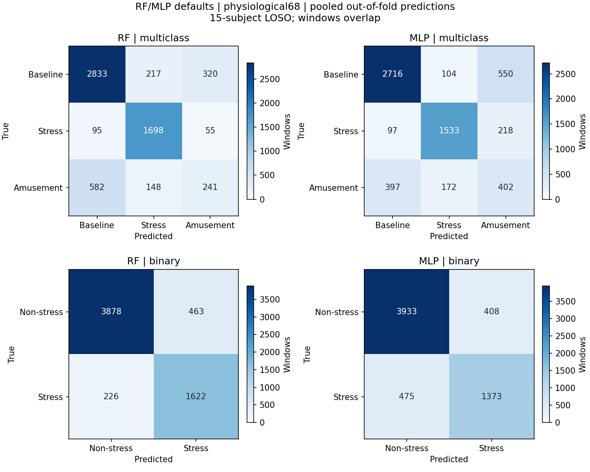
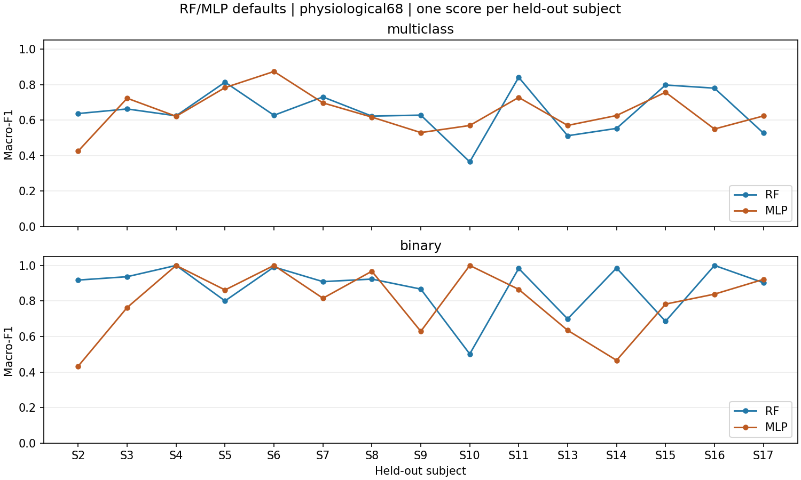

# G3 Như — RF và MLP mặc định, 08/11/2026

## Chốt bàn giao sau cập nhật Mai

Đã cập nhật checkout tới `813a11b` và đọc [tổng hợp G3 của Mai](G3_TONG_HOP.md). Mai đã nhận gói RF/MLP, kiểm tra 261 tệp checksum bàn giao và đưa vào bảng đủ sáu mô hình: 180 fold, 74.268 dự đoán ngoài mẫu. Đây là trạng thái tổng hợp Mai công bố; lượt rà này không nhận lại ZIP dự đoán của cả sáu mô hình.

Như đã kiểm tra lại ZIP gốc trên máy có SHA-256 đúng gói Mai ghi nhận; chạy lại bước **xác minh** 60 fold gốc, không train lại. Toàn bộ 60 dòng metric RF/MLP trong bảng nhóm khớp chính xác bảng gốc, gồm task/model/subject, số mẫu, điểm và thời gian; bốn nhóm summary/mean/std/confusion matrix cũng khớp. Bằng chứng: [group_acceptance_check.json](../reports/g3_nhu/group_acceptance_check.json).

| Yêu cầu G3 của Như | Trạng thái |
| --- | --- |
| RF/MLP mặc định, seed 42 | Đã chạy và lưu tham số thật |
| Ba lớp và nhị phân, đủ 15 lượt LOSO | Đủ 60 fold, 24.756 dự đoán |
| Ghi thời gian và hội tụ | Có thời gian từng fold; không ghi warnings trong lượt main |
| Trực quan sơ bộ | Có confusion matrix và Macro-F1 từng subject |
| Bàn giao, rà sau khi Mai hợp nhất | Gói đã được nhận, số liệu RF/MLP trong bảng nhóm khớp |

**Phần G3 cơ bản được phân công của Như đã hoàn tất.** Không còn lượt train bổ sung bắt buộc trong G3 ở bản này. Giữ các mục tuning/biến thể, phân tích sâu và hình báo cáo cuối cho các giai đoạn sau hoặc góp ý cụ thể. Lượt này chỉ chốt kiểm tra và bàn giao, không đổi mô hình, dữ liệu hay tạo gói ZIP mới.

Giới hạn nguồn runtime KNN/SVM được Mai ghi trong báo cáo nhóm vẫn giữ nguyên; kết quả rà RF/MLP không nâng thành chứng nhận mọi producer cùng source runtime. Không thực hiện kiểm định hoặc kết luận chất lượng sinh lý trong bước chốt G3 này.

Đã hoàn thành phần chạy RF/MLP mặc định và hình sơ bộ: hai bài toán, mỗi mô hình/bài toán đủ 15 lượt LOSO. Tổng **60 fold, 24.756 dự đoán ngoài mẫu**. Phạm vi chỉ phần Như; chưa ghi G3 toàn nhóm hoàn tất hoặc thực hiện tuning G4.

## Dữ liệu và cách chạy

- Bộ chung `physiological_68_v1`: 6.189 cửa sổ, 68 feature, 15 người. CSV SHA-256 `2f2fddd678f333a800f2869d2e78b407934b2c3492190ed70e28d8a9107fd8ba` đúng khóa `configs/defaults.yaml`.
- Chạy bằng **runner G3 chung** `scripts/run_g3_baselines.py --models rf mlp`, cùng giao thức với gói Dummy/LR của Mai để bàn giao/hợp nhất. Không thay nguồn tính G2 hoặc quy tắc đánh giá.
- RF: RandomForestClassifier mặc định, random_state=42, n_jobs=1. MLP: MLPClassifier mặc định, random_state=42, max_iter=200. Đã đối chiếu toàn bộ get_params với mặc định của phiên bản thư viện đang khóa.
- Main dùng pipeline chung trong `models.py`: median imputer cho RF; median imputer + StandardScaler cho MLP. Khác pipeline factory chuẩn bị/quick riêng (có scaler cả RF), không sử dụng factory đó trong gói main này. RF không cần scaler theo giao thức chung; không trộn số liệu từ các lượt quick vào main.
- Mỗi fold 14 người train, một người test. Imputer/scaler chỉ fit trên train; giữ đủ feature với keep_empty_features=True. Không dùng metadata làm X, không loại hàng để né BVP thiếu, không tuning/selection/resampling hoặc class balancing.
- Hai bài toán: ba lớp [1,2,3], nhị phân [0,1]. Macro-F1 dùng nhãn cố định, zero_division=0; Balanced Accuracy theo các lớp có thật trong test. Chính sách thiếu lớp train là báo lỗi theo giao thức chung.

## Kết quả ngoài mẫu

Trung bình ± độ lệch chuẩn mẫu (`ddof=1`) qua 15 người; không phải điểm fit toàn bảng hoặc điểm gộp theo cửa sổ.

| Bài toán | Mô hình | Macro-F1 | Balanced Accuracy |
| --- | --- | ---: | ---: |
| Ba lớp | RF | 0.6480 ± 0.1297 | 0.6700 ± 0.1204 |
| Ba lớp | MLP | 0.6462 ± 0.1144 | 0.6815 ± 0.1050 |
| Nhị phân | RF | 0.8735 ± 0.1440 | 0.8865 ± 0.1143 |
| Nhị phân | MLP | 0.7986 ± 0.1846 | 0.8225 ± 0.1671 |

Không ghi nhận warnings ở cả 60 fold, bao gồm cảnh báo chưa hội tụ MLP. Không tự tăng max_iter. Việc không có cảnh báo không chứng minh mô hình tối ưu hoặc dữ liệu đã đạt chất lượng sinh lý.

Điểm thay đổi đáng kể giữa các subject; kết quả nhị phân 1.0 trên S4 ở lượt thử không đại diện cho toàn bộ 15 người. Nhiều nhầm lẫn ba lớp liên quan Amusement/Baseline trong confusion matrix; đây là quan sát mô tả, chưa làm kiểm định hoặc phân tích nguyên nhân sâu. Hạn chế thiếu đặc trưng nhịp BVP của G2 còn nguyên; đây là hiệu năng với imputation trong train, không phải bằng chứng đã sửa BVP.

## Kiểm tra và bằng chứng

- `verify_run` kiểm tra lại toàn bộ 60 fold và 24.756 dự đoán: đủ subject/tập cửa sổ, không trùng khóa, nhãn thật đúng dữ liệu gốc; không giao subject train/test.
- Tính lại Macro-F1, Balanced Accuracy, confusion matrix và mean/std từ dự đoán; khớp số đã lưu. Kiểm tra hash fold, chữ ký, khóa CSV và source snapshot chuẩn hóa LF.
- Summary trạng thái `complete` cho RF/MLP; scope `main`. Không nhập checkpoint hoặc dự đoán quick vào gói này.
- Báo cáo nhỏ: [main_results.json](../reports/g3_nhu/main_results.json), [main_metrics_by_subject.csv](../reports/g3_nhu/main_metrics_by_subject.csv), 60 dòng metric. Thông tin nguồn/môi trường và tham số thực được giữ trong báo cáo/gói.
- ZIP bàn giao được đọc lại kiểm tra tính toàn vẹn và hash từng tệp, không chỉ nén rồi bỏ qua kiểm tra.

## Hình sơ bộ



Ma trận đếm gộp dự đoán ngoài mẫu theo đúng thứ tự nhãn; hàng là nhãn thật, cột là dự đoán. Không coi các cửa sổ chồng lấp là quan sát độc lập để kiểm định.



Hai hình đã render và kiểm tra trực quan. Script `scripts/plot_nhu_g3.py` chỉ đọc số liệu đã lưu; dùng matplotlib của Python hệ thống do môi trường train chưa có matplotlib. Không train/tính lại feature trong môi trường vẽ; thông tin vẽ được ghi ở plot_environment.json. Đào tạo và xác minh số liệu vẫn dùng Python 3.12.14 của `.venv-g1`.

## Gói gửi Mai ngoài Git

- Thư mục: `outputs/g3_nhu_rf_mlp_phys68_main_20261108/`.
- ZIP: `outputs/g3_nhu_rf_mlp_phys68_main_20261108.zip`.
- Có predictions, metrics, summary, splits, config YAML/JSON, môi trường, model parameters, source_snapshot.zip, verification, log và checkpoint/hash từng fold; kèm schema đầu vào và hai hình.
- `handoff_checksums.json` ghi hash tệp bàn giao. ZIP hash và kích thước trong main_results.json.
- Mai nhận nguyên gói và kiểm tra bằng công cụ hợp nhất G3 chung; gói này chỉ có RF/MLP, không kết luận Nam hoặc Mai chưa chạy các mô hình của họ.

## Lệnh chạy lại

Chạy tại project, giữ đúng khóa dữ liệu và dùng output mới nếu thay code/settings/data. `--resume` chỉ dùng lại checkpoint hợp lệ cùng chữ ký.

```powershell
.\.venv-g1\Scripts\python.exe -X utf8 scripts/run_g3_baselines.py --config configs/defaults.yaml --models rf mlp --output outputs/g3_nhu_rf_mlp_main_lan2 --resume
python scripts/plot_nhu_g3.py --run outputs/g3_nhu_rf_mlp_main_lan2 --output reports/g3_nhu/main_figures_lan2
```

Bản G3 cơ bản phần Như đã có dự đoán, điểm và hình sơ bộ. Để các đợt sau: tuning G4, so sánh biến thể, phân tích lỗi/overfit sâu và hình phục vụ báo cáo cuối. Không tạo thêm thử nghiệm trong lượt này. Người dùng tự commit/push và gửi ZIP; dữ liệu/dự đoán chi tiết vẫn ngoài Git.
