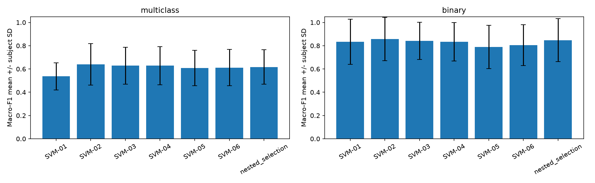
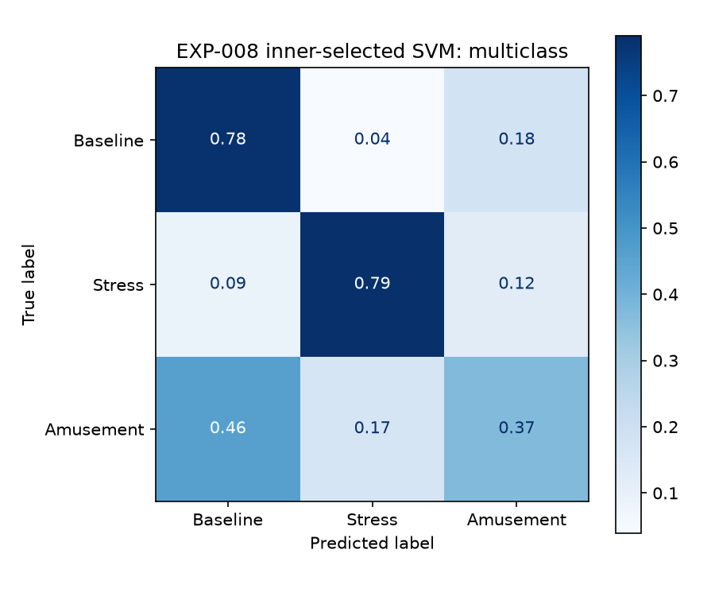
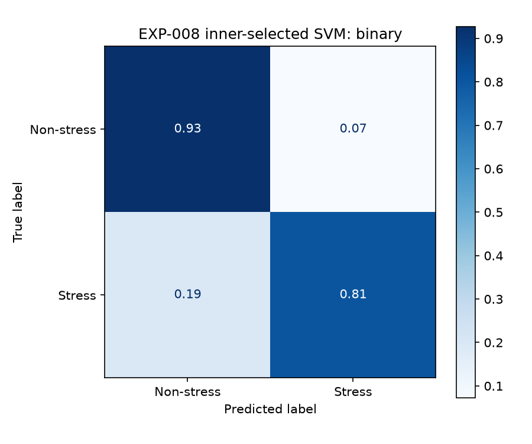

# EXP-008 — Sáu thực nghiệm SVM của Thái

Bổ sung theo yêu cầu ngày 22/11/2026. Giữ nguyên hồ sơ lịch sử của Nam. Sáu thực nghiệm là sáu cấu hình RBF cố định, không phải sáu thuật toán tìm kiếm độc lập. C = 0.1/1/10, gamma = 0.001/0.01, 68 features, không cân bằng lớp hoặc chọn đặc trưng.

Mỗi run: 15 subject × hai task = 30 outer fold, 12.378 dự đoán OOF. Median imputation và scaling fit riêng trong mỗi inner/outer train. Mỗi outer subject chọn cấu hình từ sáu run bằng Macro-F1 trung bình của cùng ba inner group split. Điểm outer không được dùng để chọn cấu hình. Hòa điểm chọn run xuất hiện trước trong YAML.

| Run | C | Gamma | Task | Macro-F1 ± SD | Balanced Accuracy ± SD |
|---|---|---|---|---|---|
| SVM-01 | 0.1 | 0.001 | binary | 0.8346 ± 0.1942 | 0.8434 ± 0.1692 |
| SVM-01 | 0.1 | 0.001 | multiclass | 0.5370 ± 0.1169 | 0.5844 ± 0.1064 |
| SVM-02 | 0.1 | 0.01 | binary | 0.8570 ± 0.1863 | 0.8759 ± 0.1638 |
| SVM-02 | 0.1 | 0.01 | multiclass | 0.6396 ± 0.1774 | 0.6736 ± 0.1632 |
| SVM-03 | 1.0 | 0.001 | binary | 0.8415 ± 0.1601 | 0.8548 ± 0.1445 |
| SVM-03 | 1.0 | 0.001 | multiclass | 0.6280 ± 0.1594 | 0.6654 ± 0.1399 |
| SVM-04 | 1.0 | 0.01 | binary | 0.8346 ± 0.1654 | 0.8528 ± 0.1541 |
| SVM-04 | 1.0 | 0.01 | multiclass | 0.6287 ± 0.1638 | 0.6688 ± 0.1562 |
| SVM-05 | 10.0 | 0.001 | binary | 0.7892 ± 0.1853 | 0.8142 ± 0.1725 |
| SVM-05 | 10.0 | 0.001 | multiclass | 0.6076 ± 0.1525 | 0.6438 ± 0.1398 |
| SVM-06 | 10.0 | 0.01 | binary | 0.8052 ± 0.1754 | 0.8275 ± 0.1588 |
| SVM-06 | 10.0 | 0.01 | multiclass | 0.6116 ± 0.1560 | 0.6523 ± 0.1502 |
| nested_selection | per_fold_inner_cv | per_fold_inner_cv | binary | 0.8480 ± 0.1852 | 0.8645 ± 0.1624 |
| nested_selection | per_fold_inner_cv | per_fold_inner_cv | multiclass | 0.6174 ± 0.1482 | 0.6480 ± 0.1310 |

## Phân tích theo subject và lỗi

- binary: Δ F1 SVM−LR=-0.0287; 7 subject tăng, 7 giảm. Train-test gap trung bình 0.1246. Subject khó: S2 (0.4139), S9 (0.5507), S13 (0.6019).
- multiclass: Δ F1 SVM−LR=-0.0113; 8 subject tăng, 7 giảm. Train-test gap trung bình 0.3286. Subject khó: S16 (0.3617), S2 (0.4400), S13 (0.4691).
- Binary: bỏ sót Stress 357 cửa sổ; báo động sai 315 cửa sổ.

## Kết luận và giới hạn

comparison.csv chứa đủ sáu cấu hình và quy trình nested_selection; paired_lr_comparison.csv chứa đủ 15 cặp subject mỗi task. Không chọn run có outer score cao nhất để báo cáo như một quy trình tuning. Các lớp trong pooled_class_metrics.csv gộp cửa sổ để phân tích lỗi, không thay mean ± SD qua subject. Không khẳng định ý nghĩa thống kê từ chênh lệch trung bình. Benchmark đã được xem nhiều lần, số người nhỏ, chưa có external holdout; chỉ kết luận thăm dò, chưa chọn mô hình thắng cả nhóm.

Nguồn: configs/exp008_thai.yaml; experiments/02_tuning/EXP-008_SVM_Thai/runs/SVM-01…06; reports/lr_workflow_20261121/tuning_results.csv. Notebook hiển thị kết quả lưu từ runner; ô notebook không được ghi là đã thực thi qua Jupyter.

Tái kiểm tra: `.\.venv\Scripts\python.exe scripts/report_exp008_thai.py`.
