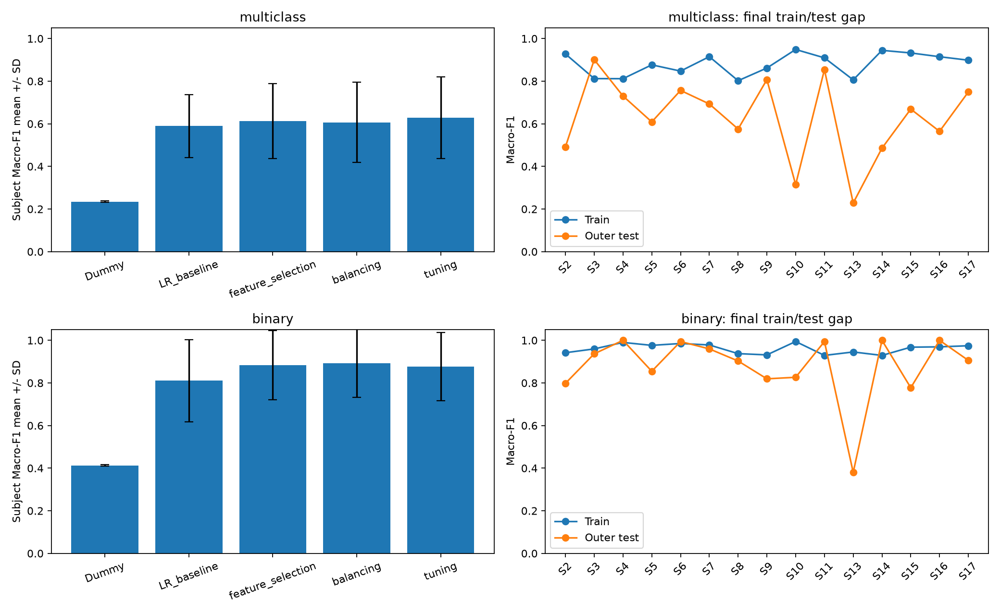
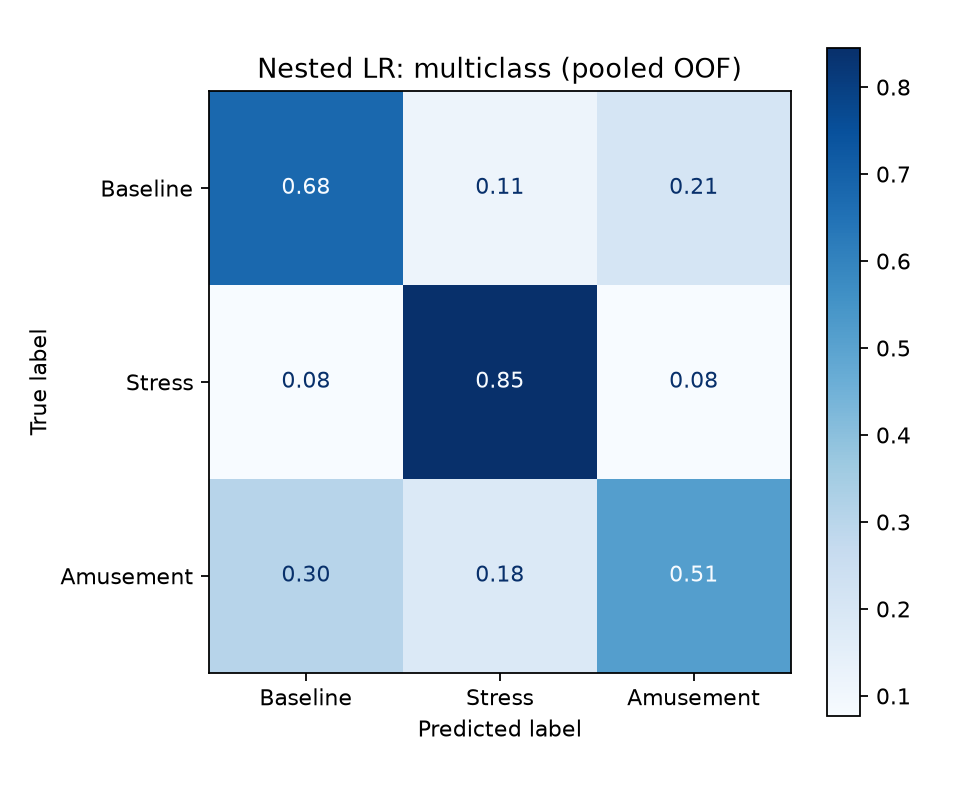
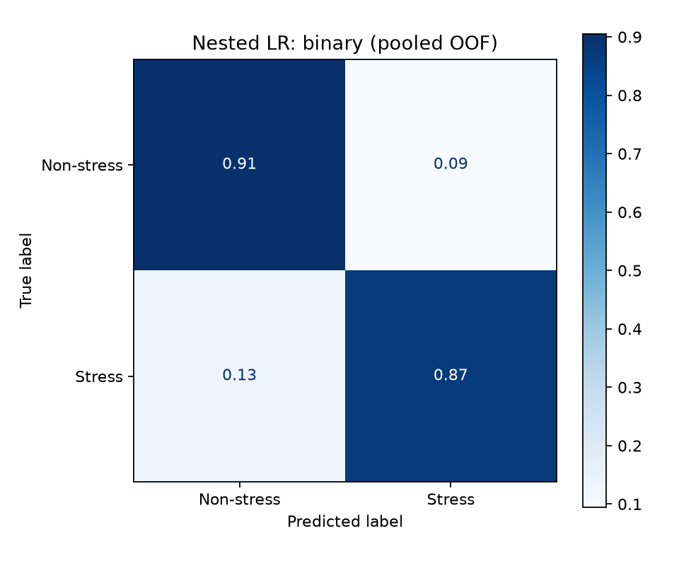

# LR: kết quả chuỗi thực nghiệm ngày 21/11/2026

Phạm vi: phần Dummy/LR của Thái. Hoàn tất 3 selection + 3 balancing + 5 tuning; selection đã hoàn tất trước ngày 21/11. Tám run BAL/TUNE được chạy và commit riêng ngày 21/11.

## Thiết kế và nghiệm thu

6.189 cửa sổ, 68 đặc trưng, 15 subject; hai bài toán. Mỗi run có 30 outer LOSO fold và 12.378 dự đoán OOF. Inner GroupKFold(3) chỉ dùng 14 subject train. Median imputation, scaling, selection và trọng số lớp được fit trong pipeline. Mọi run được kiểm tra checksum, khóa OOF, nhãn, điểm F1/BA tính lại, confusion matrix, split theo người, gate phụ thuộc, cấu hình và SD mẫu.

Các dòng feature_selection/balancing/tuning ghép kết quả theo quyết định inner CV riêng từng task/outer subject; không chọn run theo điểm outer test. Chi tiết từng run nằm trong comparison.csv; quyết định nằm trong inner_decisions.csv.

| Giai đoạn | Task | Macro-F1 ± SD | Balanced Accuracy ± SD | Δ F1 so LR | Subject tăng/giảm |
|---|---|---|---|---|---|
| Dummy | binary | 0.4123 ± 0.0035 | 0.5000 ± 0.0000 | -0.3980 | 1/13 |
| Dummy | multiclass | 0.2350 ± 0.0023 | 0.3333 ± 0.0000 | -0.3543 | 0/15 |
| LR_baseline | binary | 0.8103 ± 0.1938 | 0.8304 ± 0.1752 | +0.0000 | 0/0 |
| LR_baseline | multiclass | 0.5894 ± 0.1484 | 0.6315 ± 0.1394 | +0.0000 | 0/0 |
| feature_selection | binary | 0.8838 ± 0.1618 | 0.8940 ± 0.1320 | +0.0736 | 10/4 |
| feature_selection | multiclass | 0.6129 ± 0.1761 | 0.6587 ± 0.1431 | +0.0235 | 11/4 |
| balancing | binary | 0.8931 ± 0.1612 | 0.9046 ± 0.1241 | +0.0829 | 11/3 |
| balancing | multiclass | 0.6070 ± 0.1882 | 0.6573 ± 0.1523 | +0.0176 | 11/4 |
| tuning | binary | 0.8767 ± 0.1591 | 0.8872 ± 0.1241 | +0.0664 | 8/6 |
| tuning | multiclass | 0.6287 ± 0.1908 | 0.6801 ± 0.1537 | +0.0393 | 11/4 |

## Từng phương án cân bằng và tuning

Các số dưới đây dùng để mô tả kết quả; quyết định chuyển bước vẫn lấy inner CV. BAL-02/03 được đối chiếu với BAL-01 để tách tác động trọng số lớp. Mỗi TUNE được đối chiếu với gate balancing. paired_step_deltas.csv chứa đủ cặp subject.

| Run | Task | Macro-F1 ± SD | Δ F1 so bước đối chiếu | Subject tăng/giảm |
|---|---|---|---|---|
| BAL-01 | binary | 0.8838 ± 0.1618 | +0.0000 | 0/0 |
| BAL-01 | multiclass | 0.6129 ± 0.1761 | +0.0000 | 0/0 |
| BAL-02 | binary | 0.9003 ± 0.1675 | +0.0165 | 6/7 |
| BAL-02 | multiclass | 0.6207 ± 0.2041 | +0.0079 | 7/8 |
| BAL-03 | binary | 0.8948 ± 0.1609 | +0.0110 | 6/4 |
| BAL-03 | multiclass | 0.6223 ± 0.1983 | +0.0094 | 8/7 |
| TUNE-01 | binary | 0.8905 ± 0.1729 | -0.0026 | 4/7 |
| TUNE-01 | multiclass | 0.6628 ± 0.1763 | +0.0558 | 9/6 |
| TUNE-02 | binary | 0.9008 ± 0.1610 | +0.0077 | 6/4 |
| TUNE-02 | multiclass | 0.6342 ± 0.1712 | +0.0272 | 7/8 |
| TUNE-03 | binary | 0.8931 ± 0.1612 | +0.0000 | 0/0 |
| TUNE-03 | multiclass | 0.6070 ± 0.1882 | +0.0000 | 0/0 |
| TUNE-04 | binary | 0.8860 ± 0.1636 | -0.0071 | 4/6 |
| TUNE-04 | multiclass | 0.5889 ± 0.2115 | -0.0181 | 5/8 |
| TUNE-05 | binary | 0.8818 ± 0.1660 | -0.0113 | 4/6 |
| TUNE-05 | multiclass | 0.5766 ± 0.2208 | -0.0304 | 5/9 |

## Phân tích lỗi

- binary: subject khó nhất: S13 (F1=0.3801), S15 (F1=0.7775), S2 (F1=0.7981). Train-test gap trung bình 0.0840.
- multiclass: subject khó nhất: S13 (F1=0.2284), S10 (F1=0.3146), S14 (F1=0.4857). Train-test gap trung bình 0.2520.
- binary/Non-stress: precision=0.9422, recall=0.9053, F1=0.9234 (gộp cửa sổ OOF).
- binary/Stress: precision=0.7963, recall=0.8696, F1=0.8314 (gộp cửa sổ OOF).
- multiclass/Baseline: precision=0.8393, recall=0.6786, F1=0.7505 (gộp cửa sổ OOF).
- multiclass/Stress: precision=0.7354, recall=0.8452, F1=0.7865 (gộp cửa sổ OOF).
- multiclass/Amusement: precision=0.3731, recall=0.5149, F1=0.4327 (gộp cửa sổ OOF).
- Binary: bỏ sót Stress 241 cửa sổ; báo động sai 411 cửa sổ.







## Kết luận và giới hạn

Báo cáo đầy đủ mức tăng/giảm theo subject trong paired_subject_deltas.csv. Điểm từng lớp và confusion matrix gộp cửa sổ dùng để phân tích lỗi, không thay thế mean ± SD theo 15 subject. Train score dùng chẩn đoán, không phải test score. Không suy ra ý nghĩa thống kê từ chênh lệch trung bình.

Việc tái sử dụng inner splits ở các bước là quy trình lựa chọn tuần tự đã định trước; inner score có thể lạc quan. WESAD đã được nhóm xem nhiều lần, chỉ có 15 người trong phòng thí nghiệm và chưa có external holdout. Kết quả mang tính thăm dò; không tuyên bố LR là mô hình tốt nhất nhóm khi chưa so sánh KNN/SVM/RF/MLP.

Bàn giao tiếp theo theo lịch 22/11: xuất model LR ứng viên, schema/metadata, kiểm tra save/load và ví dụ dự đoán CSV; ghép kết quả các thành viên trước 10:00.

## Tái kiểm tra

```powershell
.\.venv\Scripts\python.exe scripts/report_lr_workflow.py
```

Nguồn ảnh và số liệu: các runs trong experiments, các gate lr_*_gate.json; verification.json ghi hash hồ sơ nguồn và mọi file báo cáo.
